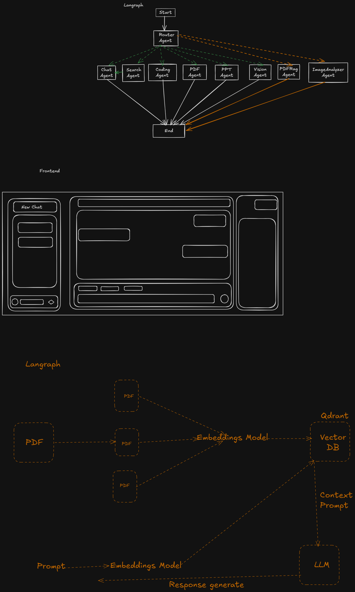
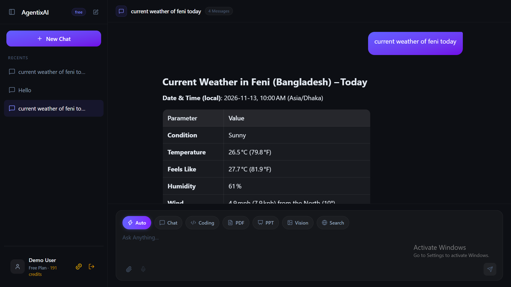
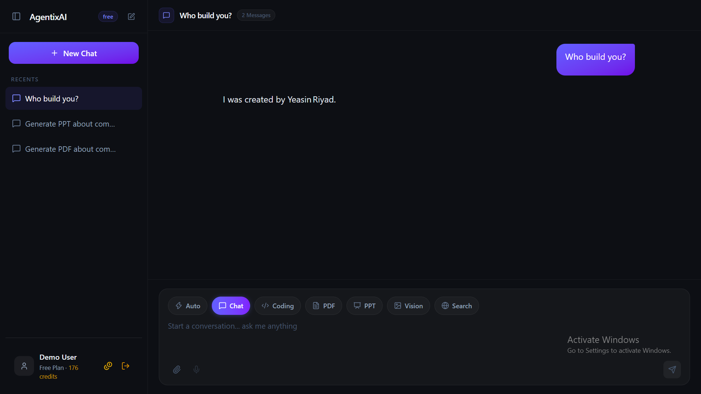
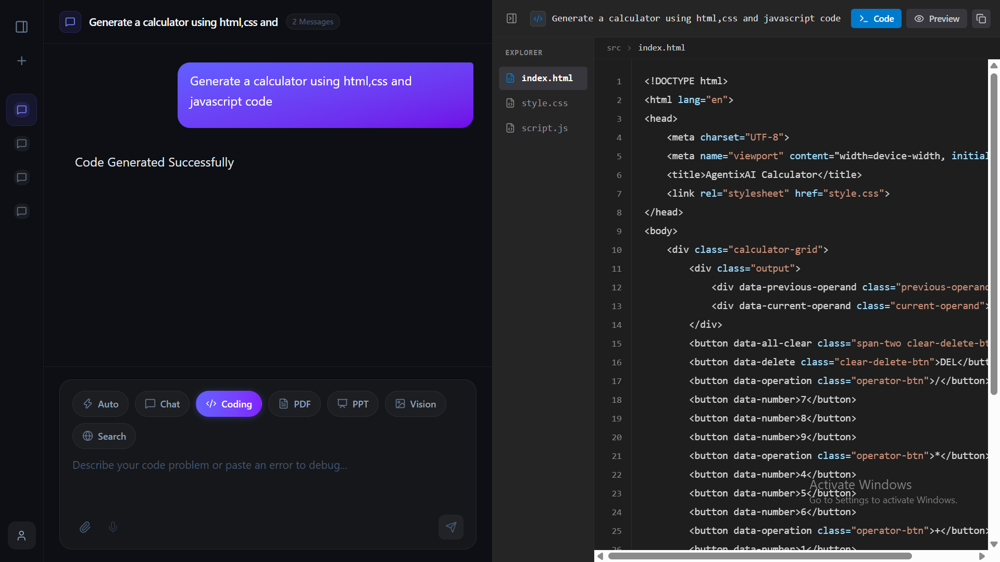
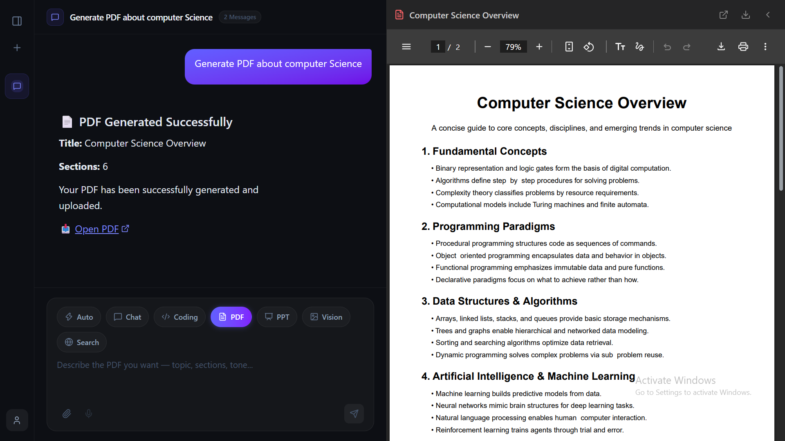
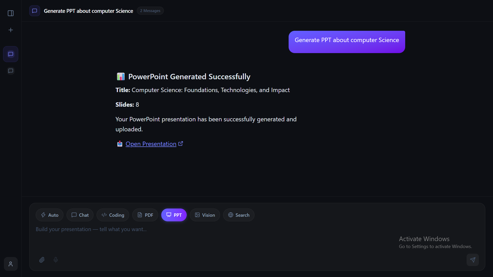
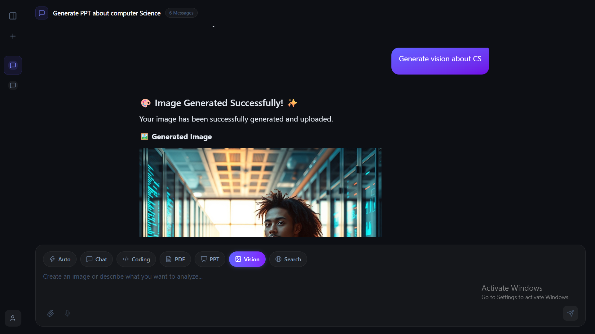
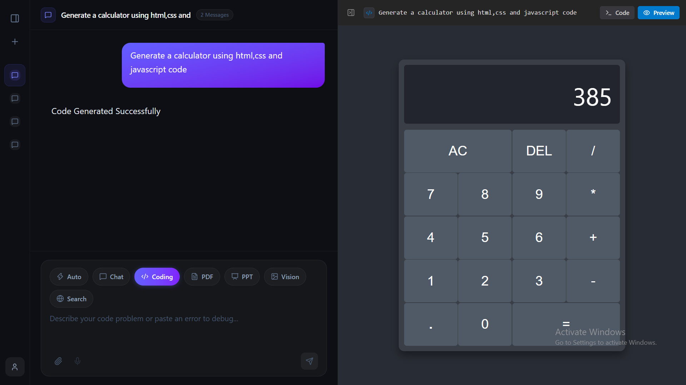
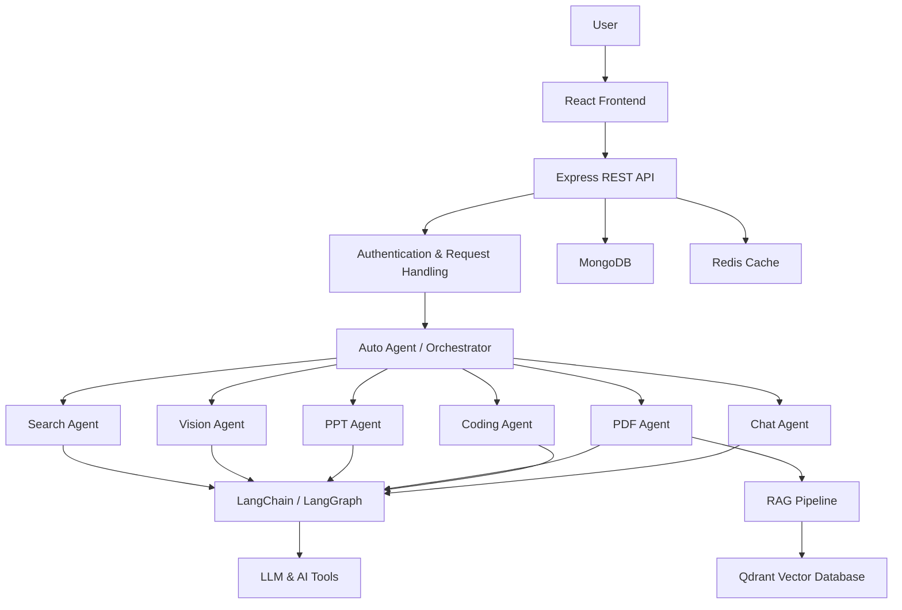

# 🤖 AgentixAI — Multi-Agent AI Platform

<p align="center">
  <strong>Build. Orchestrate. Automate. Think Intelligently.</strong>
</p>

<p align="center">
  An intelligent, scalable, and production-oriented Multi-Agent AI platform designed to bring multiple AI capabilities together into one unified workspace.
</p>

<p align="center">
  
  
  
  
  
  
</p>

---

## 📌 Overview

**AgentixAI** is a powerful Multi-Agent AI platform that combines the MERN stack with modern AI technologies to deliver intelligent, specialized AI experiences.

Instead of relying on a single AI assistant, AgentixAI provides multiple specialized agents, each designed to handle different types of tasks, including general conversations, coding assistance, document understanding, presentation generation, visual analysis, and web research.

Powered by **LangChain, LangGraph, Retrieval-Augmented Generation (RAG), and Qdrant**, AgentixAI brings intelligent reasoning, agent orchestration, document retrieval, and AI tool calling into one platform.

Whether you need to write code, analyze a PDF, generate presentations, understand images, or research information, AgentixAI provides a dedicated AI experience for every task.

## ✨ Key Features

- 🤖 **Multi-Agent AI System** — Multiple specialized agents working through a unified platform.
- 🧠 **Intelligent Agent Orchestration** — Route tasks to the appropriate agent using the Auto mode.
- 🔗 **LangGraph Integration** — Build stateful, structured, and multi-step AI workflows.
- ⚡ **LangChain Integration** — Develop powerful LLM-powered applications and agent workflows.
- 📚 **RAG Architecture** — Retrieve relevant information from documents and knowledge sources.
- 🔍 **Qdrant Vector Database** — Store and retrieve vector embeddings for semantic search.
- 🚀 **Redis Caching** — Improve application performance with caching.
- 🛠️ **AI Tool Calling** — Enable AI agents to interact with external tools and execute tasks.
- 🌊 **Streaming AI Responses** — Deliver AI-generated responses progressively.
- 📄 **Document Processing** — Upload and process documents for AI-powered analysis.
- 🔐 **JWT Authentication** — Secure user authentication and protected APIs.
- 🐳 **Docker Containerization** — Containerized application infrastructure.
- ☁️ **AWS Integration** — Cloud deployment and infrastructure capabilities.
- 🏗️ **Scalable Architecture** — Organized, maintainable, and production-oriented codebase.
- 🎨 **Modern Frontend** — Responsive interface powered by React and Redux Toolkit.

---


---

## 🔄 AI Workflow Diagram

The following diagram illustrates how Agentix
processes user requests through its specialized AI agents.

<p align="center">
  
</p>

---


## 🤖 AI Agents

AgentixAI provides six specialized AI agents alongside an intelligent Auto orchestration mode.

### 1. 🧠 Auto Agent — Intelligent Orchestration

The Auto mode acts as the intelligent entry point of AgentixAI.

Instead of manually selecting an agent, users can describe their tasks, and the system can determine the appropriate agent or workflow to handle the request.

**Key Capabilities:**
- Intelligent task routing.
- Automatic agent selection.
- Multi-agent workflow orchestration.
- Context-aware task execution.
- Seamless interaction with specialized agents.



---

### 2. 💬 Chat Agent — Intelligent AI Conversations

The Chat Agent provides a general-purpose conversational AI experience for everyday questions, technical discussions, brainstorming, and problem-solving.

**Key Capabilities:**
- Natural language conversations.
- Context-aware responses.
- Technical explanations and assistance.
- Multi-turn conversations.
- Streaming AI responses.



---

### 3. 💻 Coding Agent — AI-Powered Programming Assistant

The Coding Agent is designed to assist developers with programming-related tasks, debugging, code explanations, and software development challenges.

**Key Capabilities:**
- Code generation.
- Code explanation.
- Debugging assistance.
- Problem-solving and algorithm guidance.
- Programming-related conversations.
- Development workflow assistance.



---

### 4. 📄 PDF Agent — Intelligent Document Understanding

The PDF Agent allows users to interact with PDF documents using AI-powered document processing and Retrieval-Augmented Generation (RAG).

Users can upload documents and ask questions based on their content.

**Key Capabilities:**
- PDF document upload.
- Document text extraction.
- Document understanding and analysis.
- Context-aware question answering.
- Semantic retrieval using vector embeddings.
- RAG-powered responses with document context.



---

### 5. 📊 PPT Agent — AI Presentation Assistant

The PPT Agent focuses on presentation-related tasks, helping users transform ideas and information into structured presentation content.

**Key Capabilities:**
- Presentation content generation.
- Topic-based slide planning.
- Structured presentation outlines.
- AI-powered content organization.
- Presentation-related assistance.



---

### 6. 👁️ Vision Agent — AI-Powered Visual Understanding

The Vision Agent enables users to interact with visual information and extract meaningful insights from images.

**Key Capabilities:**
- Image understanding.
- Visual question answering.
- Image content analysis.
- Object and scene interpretation.
- Context-aware visual explanations.



---

### 7. 🔎 Search Agent — Intelligent Web Research

The Search Agent helps users research topics, discover relevant information, and find answers using search-powered AI workflows.

**Key Capabilities:**
- AI-powered information discovery.
- Web research assistance.
- Topic exploration.
- Information summarization.
- Research-oriented question answering.



---

## 🏗️ Technology Stack

AgentixAI combines modern frontend, backend, AI, database, and infrastructure technologies.

### Frontend Development
| Technology | Purpose |
|---|---|
| React.js | Component-based UI development |
| Redux Toolkit | Global state management |

### Backend Development
| Technology | Purpose |
|---|---|
| Node.js | Backend runtime |
| Express.js | REST API development |
| JWT | Authentication and authorization |
| REST APIs | Client-server communication |

### AI & Agent Frameworks
| Technology | Purpose |
|---|---|
| LangChain | LLM application development |
| LangGraph | Agent orchestration and workflows |
| RAG | Context-aware information retrieval |
| AI Tool Calling | Tool-based agent execution |

### Database & Caching
| Technology | Purpose |
|---|---|
| MongoDB | Application data storage |
| Qdrant | Vector database and semantic retrieval |
| Redis | Caching and performance optimization |

### DevOps & Cloud
| Technology | Purpose |
|---|---|
| Docker | Application containerization |
| AWS | Cloud infrastructure and deployment |

---

## 🧠 AI Architecture

AgentixAI follows a multi-agent architecture where specialized agents handle different categories of user requests.

The Auto mode acts as an orchestration layer that can identify the appropriate workflow and delegate tasks to specialized agents.



---

## 📂 Project Structure

The project follows a modular and scalable folder organization. The exact directory structure may vary depending on the implementation.

```text
AgentixAI/
│
├── frontend/
│   ├── public/
│   └── src/
│       ├── assets/
│       ├── components/
│       ├── features/
│       ├── pages/
│       ├── hooks/
│       ├── redux/
│       ├── services/
│       └── utils/
│
├── backend/
│   └── src/
│       ├── config/
│       ├── controllers/
│       ├── middlewares/
│       ├── models/
│       ├── routes/
│       ├── services/
│       ├── agents/
│       │   ├── auto/
│       │   ├── chat/
│       │   ├── coding/
│       │   ├── pdf/
│       │   ├── ppt/
│       │   ├── vision/
│       │   └── search/
│       ├── graph/
│       ├── tools/
│       ├── utils/
│       └── server.js
│
├── screenshots/
│   ├── auto.png
│   ├── chat.png
│   ├── coding.png
│   ├── pdf.png
│   ├── ppt.png
│   ├── vision.png
│   └── search.png
│
├── docker-compose.yml
├── .gitignore
└── README.md
```

---

## ⚙️ Getting Started

Follow these instructions to set up AgentixAI locally.

### Prerequisites

Make sure you have the following installed:

- Node.js
- npm
- MongoDB
- Redis
- Docker (optional)
- Qdrant (for vector database functionality)
- Required AI provider API keys

### 1. Clone the Repository

```bash
git clone https://github.com/yeasin-riyad/Multi-Agent-Ai-Platform-Microservices-Architecture.git

cd AgentixAI
```

### 2. Install Dependencies

Install frontend and backend dependencies separately.

```bash
# Frontend
cd frontend
npm install

# Backend
cd ../backend
npm install
```

### 3. Configure Environment Variables

Create a `.env` file inside the backend directory.

```env
# Server
PORT=8000
NODE_ENV=development

# Database
MONGODB_URI=your_mongodb_connection_string

# Authentication
JWT_SECRET=your_jwt_secret

# AI Provider
GROQ_API_KEY=your_groq_api_key

# Vector Database
QDRANT_URL=your_qdrant_url
QDRANT_API_KEY=your_qdrant_api_key

# Redis
REDIS_URL=your_redis_connection_url


Configure the environment variables according to the services and integrations enabled in your implementation. Never commit real credentials or API keys.

### 4. Run the Backend

```bash
cd backend
npm run dev
```

### 5. Run the Frontend

Open another terminal:

```bash
cd frontend
npm run dev
```

### 6. Access the Application

Open the local frontend URL displayed by your development server, typically:

```text
http://localhost:5173
```

---

## 🐳 Docker Support

AgentixAI is designed with containerization in mind.

Build and start the configured Docker services:

```bash
docker compose up --build
```

Stop the containers:

```bash
docker compose down
```

Make sure your Docker Compose configuration and environment variables are properly configured before running these commands.

---

## 🔐 Security

Security is an important part of AgentixAI's architecture.

- JWT-based authentication.
- Protected backend routes.
- Environment-based secret management.
- Secure API communication.
- Server-side validation.
- Controlled access to application resources.

---

## 🚀 Future Improvements

Potential areas for further development include:

- [ ] Advanced multi-agent collaboration.
- [ ] More specialized AI agents.
- [ ] Improved agent memory and context management.
- [ ] Advanced observability and monitoring.
- [ ] Agent execution history and analytics.
- [ ] Background job processing.
- [ ] Advanced rate limiting and API protection.
- [ ] Automated testing and CI/CD pipelines.
- [ ] Advanced AWS deployment architecture.

---

## 🎯 Project Vision

The vision behind AgentixAI is to create a unified AI workspace where different intelligent agents work together to solve real-world problems.

By combining modern web technologies with agentic AI, retrieval-augmented generation, and intelligent orchestration, AgentixAI aims to make AI-powered productivity, development, research, and document understanding more accessible and efficient.

**One Platform. Multiple Agents. Limitless Possibilities.**

---

## 👨‍💻 Author

**Your Name**

Full-Stack Developer | Backend Development | AI & Agentic Systems

- GitHub: [Your GitHub Profile](https://github.com/yeasin-riyad)
- LinkedIn: [Your LinkedIn Profile](https://www.linkedin.com/in/mdyeasinmazumder)

---

<p align="center">
  ⭐ If you find AgentixAI interesting, consider giving this repository a star!
</p>

<p align="center">
  <strong>Built with passion for intelligent software and the future of AI.</strong>
</p>